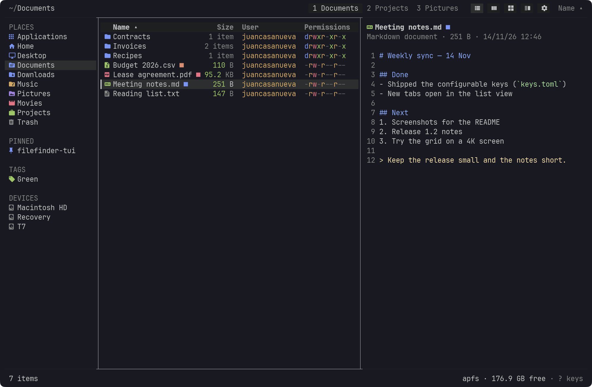
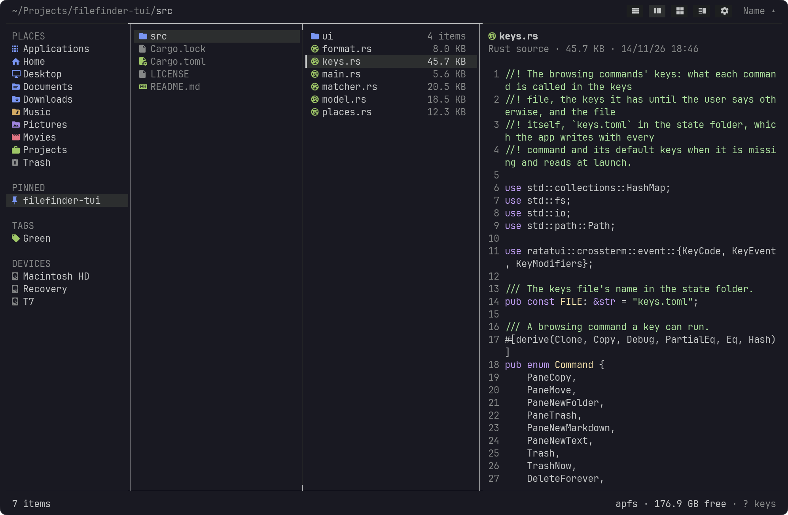
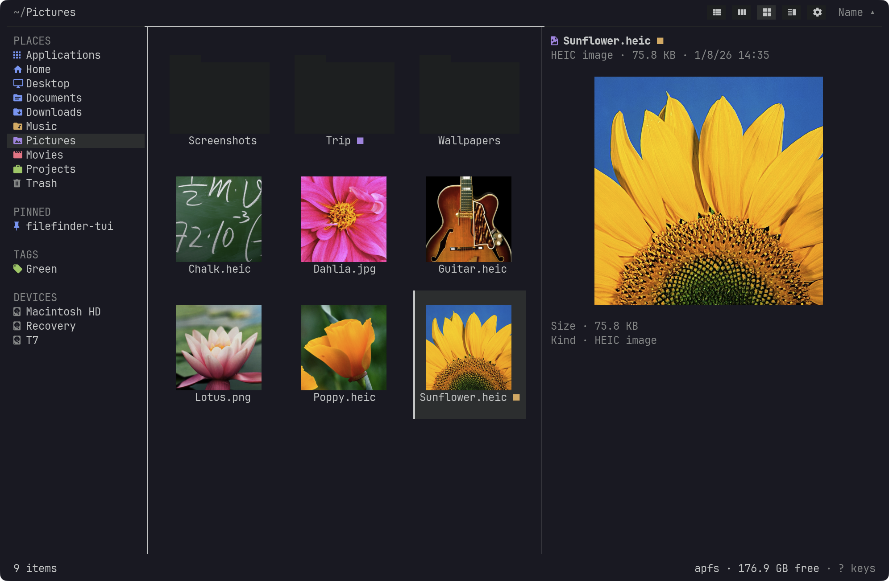
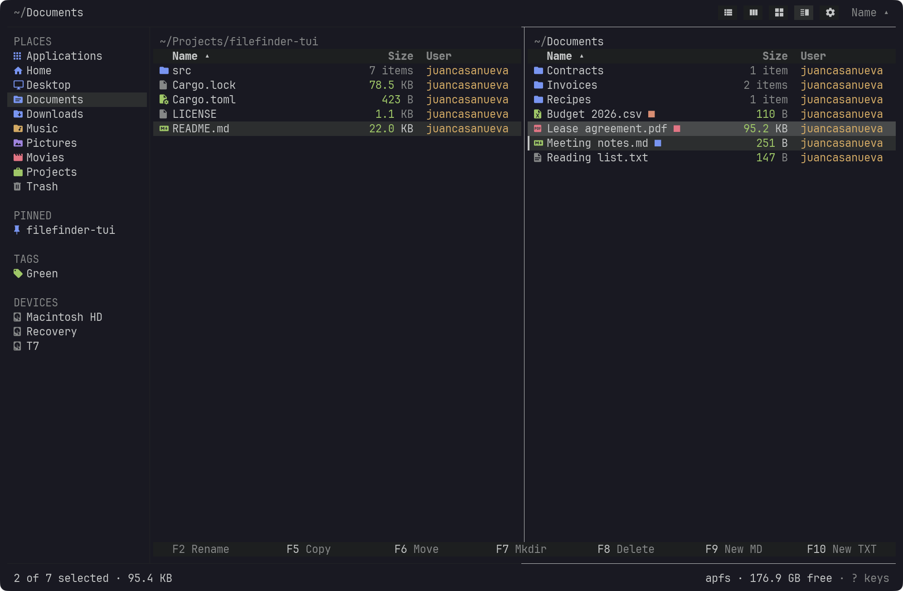
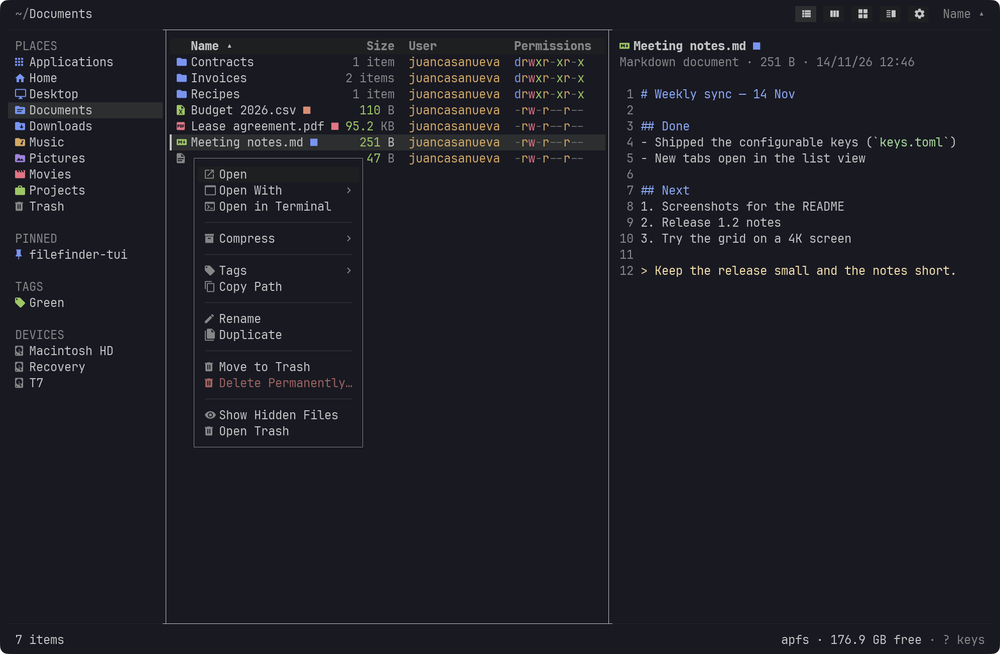
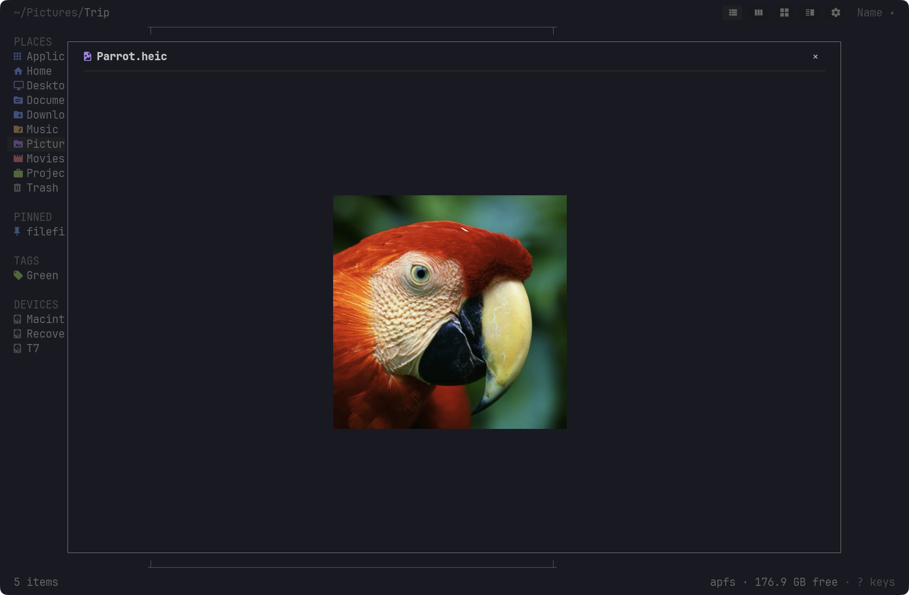
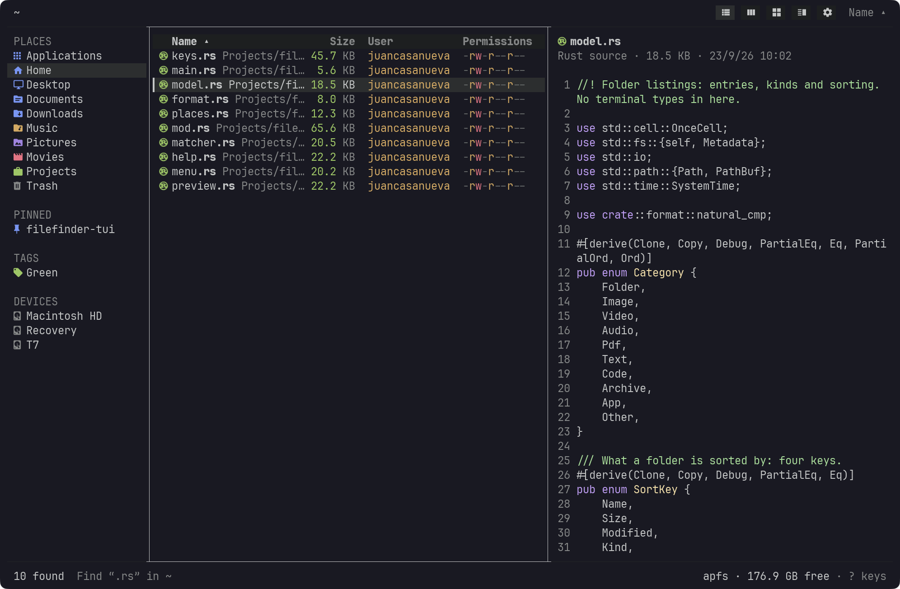
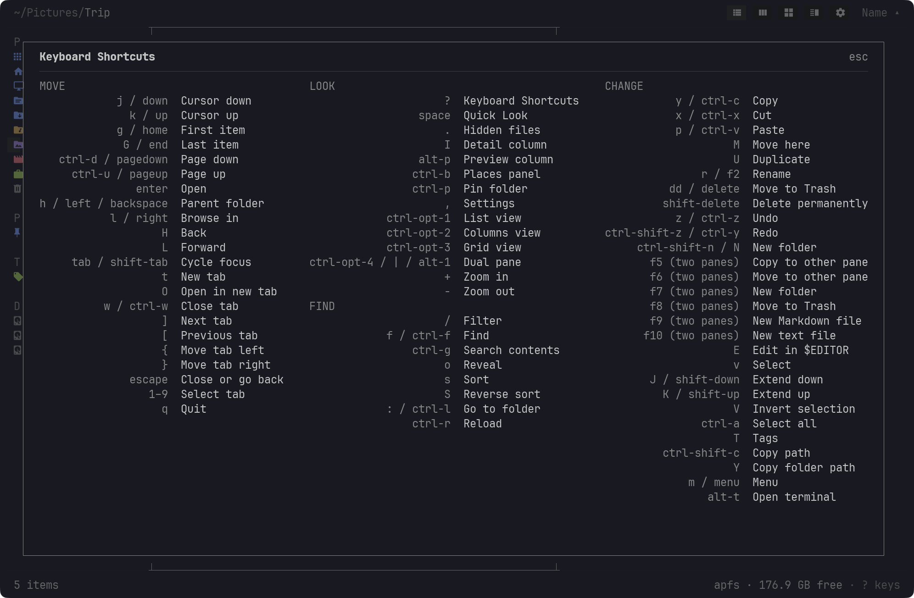
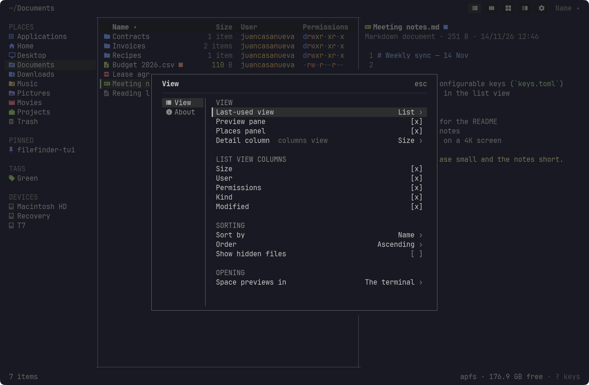

# filefinder-tui

**Website**: [filefinder-tui.vercel.app](https://filefinder-tui.vercel.app/)

A keyboard-first terminal file manager for macOS, written in Rust with [ratatui](https://ratatui.rs/). It has a header with the path, the tabs, the view and settings buttons and the sort order; then the places panel on the left, the files in the middle (a list with columns, two lists side by side, Miller columns or a grid of thumbnails) and a preview on the right; and a footer with the counts, what just happened and the free space. Colours are a quiet grey palette on your terminal's own background.

Nothing runs in the background. Folders are read when you open them, and thumbnails are made when a tile needs one.



- **The screen**: the places panel on the left, the list in the middle with a glyph and the name on each row, then the columns Size, User, Permissions, Kind and Modified, coloured the way [eza](https://github.com/eza-community/eza) colours them (the mode letter by letter, `r` yellow, `w` red, `x` green; a size's number green; your own name yellow; the kind in its glyph's colour; the date blue), under a header (the ones chosen in Settings › View › List view columns; bold titles on a fill of their own, the sorted one lit with its arrow, a click on a title sorts by it and a second click the other way; when the list is narrow the last ones make way, so the name keeps at least 20 cells), and the preview on the right. Links show in cyan with where they point, programs in green. The area with the keyboard (the panel, a pane or the preview) has its frame lit: its stretch of the rules above and below it and the lines on its sides. Alt+P hides or shows the preview, and the choice is remembered. The header has the path, the tabs, four view buttons (list, columns, grid, two panes; the one showing lit, a click switches like Ctrl+Opt+1–4; resting the pointer on one says which; dropped first when the window is narrow) and the sort order.
- **Places panel**, in every view, as wide as its longest name needs (with five cells of air, at most 22% of the window; the list takes the rest): PLACES (Applications when `/Applications` exists; Home; Desktop, Documents, Downloads, Music, Pictures, Movies and Projects when they exist; the Trash), PINNED (the folders you pinned with Ctrl+P or the menu, in the order pinned; kept in `~/.config/filefinder-tui/pinned`, one path per line, and left out of sight while a folder is gone), TAGS (the colour tags some file carries, in Finder's order, as Spotlight knows them at start, on Ctrl+R and after you tag something; opening one lists everything carrying it, everywhere) and DEVICES (the system's own volume, which opens `/`; iCloud Drive when it is on; then the other mounted volumes). The place you are in is lifted. Tab (or Shift+Tab) moves the keyboard into it; `j`/`k` move, ⏎ or `l` opens a place and gives the keyboard back to the list; a click opens one. Ctrl+B hides or shows it, and the choice is remembered. It is read at start, on Ctrl+R and when the keyboard enters it.
- **Preview pane**: the name, kind, size and date, then a folder's items, a text file's lines with line numbers (code coloured by `bat` with its ANSI theme, once it is ready; a file without an extension, like `pinned` or `.zshrc`, counts as text when its start is UTF-8 with no NUL byte), a picture with its pixel size, a PDF's first page, an app's icon, or what several selected items add up to. Tab moves the keyboard into it to scroll. Space opens a Quick Look card over the window.
- **Four views**: Ctrl+Opt+1 the list; Ctrl+Opt+2 Miller columns from home down to the folder, then the preview; Ctrl+Opt+3 a grid of real thumbnails with two-line names, beside the preview (apps show their own icon, from the `.icns` file their `Info.plist` names, and in the list, the columns and the two panes too, in place of their glyph, where the terminal draws real pictures); Ctrl+4 two lists side by side, each under its own path. **The app opens in one pane, in the list**, whatever view you used last; Ctrl+4 (or `|`, Alt+1) splits it into two panes and goes back again.
- **Tabs**: `t` opens one in the folder you are in, `O` the folder under the cursor, each in the list; `[` / `]` go round them, `1`–`9` jump to one, `{` / `}` move it, `w` closes it (the last one quits). Each tab keeps its own folder, view, panes, marks and history; the strip in the header shows once there are two, at most nine.
- **Colours**: truecolor when `COLORTERM` says so, the nearest of 256 colours otherwise, and none with `NO_COLOR` (the cursor row is then reverse video and marked rows underlined). `FILEFINDER_ICONS=plain` replaces the Nerd Font glyphs with plain marks.
- **Trash**: `~/.Trash`, with Restore and Empty Trash in its menu; reach it from the places panel, the menu or `:`.
- **File operations** that never overwrite: copy, cut, paste, duplicate, rename, new folder, compress, extract, edit in `$EDITOR`, move to the trash, and delete permanently after asking. Everything except a permanent delete can be undone.
- **Finder tags**: `T` opens the seven Finder tags (Red, Orange, Yellow, Green, Blue, Purple, Gray); `1`–`7` turns one on, or off where every selected item already has it, and Remove All Tags takes the seven off. They are real Finder tags, kept in the `com.apple.metadata:_kMDItemUserTags` attribute exactly as Finder writes it, so Finder, Spotlight and `mdfind` see them, and tags of your own stay as they are. They show as coloured squares after the name (their digits without colour), and Find takes `tag:red` (any case; every tag named must be there, and the rest of the text is looked for as usual: `tag:red holiday`). Tags alone in the everywhere scope ask Spotlight, so the whole Mac answers at once; in a folder or home the walk reads each file's tags, exact where Spotlight doesn't index. An item that loses the tag leaves the results. Undo takes a change back exactly. A drive whose file system has no room for them says "This filesystem does not support file tags."
- **Bulk rename**: `r` with several items marked puts their names in `$EDITOR`, one a line, in a private file of the system's temporary folder. Change the lines, save and quit; the renames run together, so names can swap (`a` ↔ `b`) or go round, and one undo takes them all back. The same number of lines in the same order is needed; a line that is empty, holds `/`, is `.` or `..`, is too long, repeats another, or names something else already there refuses the lot with the line it is about, and nothing is renamed. Quitting the editor with an error renames nothing either.
- **Compress and Extract**, in the menu (`m`). Compress writes zip, tar, tar.gz, tar.bz2 or tar.xz (and 7z when [7-Zip](https://www.7-zip.org/) is installed as `7zz` or `7z`), named after the item without its extension, or after the folder several are in. Extract unpacks a zip, tar, tar.gz/.tgz, tar.bz2, tar.xz (or 7z) into a new folder beside it named after it without its ending. A name in use is never written over: the next free copy name is taken (`pack copy.tar.gz`, `pack copy 2.tar.gz`, `pack copy`). An archive holding a name from the root, one with `..`, or a link that leads out of its folder is refused with nothing written; one that is damaged or needs a password says so and leaves nothing behind; Escape stops either. Undo moves what was made to the Trash.
- **Two panes** with Ctrl+Opt+4, `|` or Alt+1 to move things between folders (`y`/`x` in one, `p` or `M` in the other); the same key goes back to the view you came from.
- **Function key bar**, in two panes only: a row below the two panes and above the status line, as wide as the panes (not under the places panel), with F2 Rename, F5 Copy, F6 Move, F7 Mkdir, F8 Delete, F9 New MD and F10 New TXT, each key lit and what it does muted; one that can't run now (nothing selected, several selected for Rename, a prompt, a menu or a card open) is all muted, and a click on one does what its key does. F5 and F6 copy and move the active pane's selection into the other pane's folder, asking first as a paste does when a name is taken, and undo takes it back; F8 moves the selection to the Trash, as `dd` does, and in the Trash itself does nothing (it never deletes for good); F9 and F10 make an empty `new.md` or `new.txt` and open Rename on it. Outside two panes F5 to F10 do nothing; Shift+F10 opens the menu everywhere.
- **Filter and Find**, both typed on the bottom row. The filter (`/`) narrows the folder you are looking at as you type: part of a name in any case, or a `*` / `?` pattern; close matches (a letter or two off, depending on how long the text is) show only when nothing matches exactly. Tab widens it to every folder below. Find (`f` or Ctrl+F) walks the folders below and ranks what it finds: the whole name, then its start, the start of a word, the letters in order, and typos last. Tab looks in this folder, home, or everywhere; Ctrl+G looks inside files instead, through [ripgrep](https://github.com/BurntSushi/ripgrep) when it is installed. Go to a path with `:`.
- **Settings** (`,` or the gear after the view buttons), in a card: a rail with View and About on the left, the rows on the right. View holds what the keys already change — Last-used view, Preview pane, Places panel, Detail column, which of the list's columns show (Size, User, Permissions, Kind, Modified), Sort by, Order, Show hidden files, and Space previews in (the terminal, or macOS Quick Look) — each row doing what its key does and remembered the same way; About has the version, the license, the GitHub repository (Enter opens it), the key sheet and a link to report an issue. Tab moves between the rail and the rows, `j`/`k` between rows, `h`/`l` (or Enter) change a choice, Space (or Enter) a check, Esc or a click outside closes it.
- **Mouse friendly**: click, double-click, right-click for the menu, Ctrl+click for one more, Shift+click for a range, the wheel to move.

## Screenshots

**Miller columns** (Ctrl+Opt+2), with code coloured by `bat` in the preview.



**The grid** (Ctrl+Opt+3): real thumbnails where the terminal draws pictures (here WezTerm), and the picture in the preview.



**Two panes** (Ctrl+Opt+4 or `|`), each under its own path, with the function key bar; F2 is muted because two items are selected.



**The menu** (`m`, Menu, Shift+F10 or a right click), at the item.



**Quick Look** (Space): the item in a card over the window.



**Find** (`f`): the matches as you type, each with its folder, from the folder you are in down.



**Keyboard Shortcuts** (`?`), with the keys from your `keys.toml`; `/` filters them.



**Settings** (`,` or the gear).



The screenshots were taken in WezTerm with JetBrains Mono Nerd Font and the Tokyo Night colours, on a sample home folder.

## Requirements

- macOS, on Apple Silicon or Intel.
- A terminal with a graphics protocol for real thumbnails: Ghostty, kitty and WezTerm use the kitty protocol, and iTerm2 its own. Other terminals fall back to coarser half-block pictures.
- A terminal with the kitty keyboard protocol for chords such as Ctrl+Opt+1/2/3/4 and Ctrl+Shift+N. Ghostty, kitty, WezTerm and iTerm2 have it.
- [bat](https://github.com/sharkdp/bat) for coloured code in the preview. Homebrew installs it with the app; otherwise `brew install bat`. Without it, code shows plain.
- A [Nerd Font](https://www.nerdfonts.com/) for the icons. Without one, run with `FILEFINDER_ICONS=plain` for plain Unicode symbols.

## Installing

With [Homebrew](https://brew.sh), from the [juancasanueva/tap](https://github.com/juancasanueva/homebrew-tap) tap:

```sh
brew install juancasanueva/tap/filefinder-tui
```

`brew upgrade filefinder-tui` updates it. The binaries are on the [releases page](https://github.com/juancasanueva/filefinder-tui/releases) too.

### From source

This needs a Rust toolchain. With Homebrew: `brew install rustup && rustup default stable`. Homebrew's rustup is keg-only, so put it on your `PATH`, for example in `~/.zshrc`:

```sh
export PATH="$(brew --prefix rustup)/bin:$PATH"
```

Then straight from GitHub:

```sh
cargo install --git https://github.com/juancasanueva/filefinder-tui
```

Or from a clone:

```sh
git clone https://github.com/juancasanueva/filefinder-tui.git
cd filefinder-tui
cargo install --path .
```

Either way the binary lands in `~/.cargo/bin`, which needs to be on your `PATH`. Run the same command again to update.

## Running

```sh
filefinder-tui                          # opens the current folder
filefinder-tui ~/Pictures
filefinder-tui ~/Pictures/photo.jpg     # opens its folder with the file selected
```

From a clone, without installing: `cargo run --release -- ~/Pictures`.

## Keys

Digits are never counts. These are the default keys; the browsing commands' keys can be changed in a file (see [Changing the keys](#changing-the-keys)).

| Key | Does |
| --- | --- |
| `j` / `k`, ↓ / ↑ | Down, up |
| `g` / `G`, Home / End | First, last |
| Ctrl+D / Ctrl+U, PgDn / PgUp | Page down, page up |
| `h`, ←, Backspace | The parent folder |
| `l`, → | Browse into the folder, or open the file |
| ⏎ | Open |
| `H` / `L` | Back, forward |
| Tab, Shift+Tab | The places panel and the list, or the places panel and the two panes. The preview is passed by: the wheel scrolls it, and a click in it gives it the keyboard (`j`/`k`, the page keys and Ctrl+D/U scroll it, Esc goes back) |
| Escape | Close or go back: an error, the filter, Find (its walk first), the file work under way, the marks |
| `:`, Ctrl+L | Go to a place (Tab completes) |
| `/` | Filter this folder; in the field Tab adds its subfolders, ⏎ or ↓ keeps the filter, Escape clears it, Ctrl+A marks what it shows |
| `f`, Ctrl+F | Find below this folder; in the field Tab changes where (this folder, home, everywhere), ⏎ or ↓ moves into what it found |
| Ctrl+G | In Find's field: names or what files hold (needs `rg`) |
| `tag:red` | In Find's field: only what carries that tag |
| `o` | Show what Find found under the cursor in its own folder |
| Space | Quick Look, in the terminal (see below), or in macOS's Quick Look window: Settings › View › Space previews in |
| `.` | Show hidden files (remembered) |
| `s` / `S` | Next sort key (name, size, modified, kind) / reverse the sort |
| `I` | The columns view's detail column: size, modified, mode (`drwx------`), owner |
| `T` | Finder tags: `1`–`7` turn a tag on or off, Remove All Tags |
| Alt+P | Show or hide the preview pane |
| Ctrl+B | Show or hide the places panel |
| Ctrl+P | Pin the folder showing to the places panel, or unpin it (in the panel: unpin the pinned folder under the cursor); also Pin / Unpin in the menu for a folder |
| Ctrl+R | Reload |
| `v` | Mark or unmark the item under the cursor |
| `J` / `K`, Shift+↓ / ↑ | Mark down, up |
| `V`, Ctrl+A | Invert the marks, mark everything |
| `y`, `x`, `p` (Ctrl+C / X / V) | Copy, cut, paste |
| `M` | Move here what was copied or cut |
| `U` | Duplicate |
| `r`, F2 | Rename; with several marked, all of them in `$EDITOR` |
| `N`, Ctrl+Shift+N | New folder |
| F5 / F6 (two panes) | Copy / move the selection into the other pane's folder; what arrives is selected there, the clipboard is left as it was |
| F7 / F8 (two panes) | New folder / Move to Trash (in the Trash, F8 does nothing) |
| F9 / F10 (two panes) | An empty `new.md` / `new.txt` (`new 2.md` and so on when taken), selected with Rename open on it |
| `dd`, Delete | Move to Trash |
| Shift+Delete | Delete permanently (a card asks first; Cancel is the default) |
| `z`, Ctrl+Z | Undo |
| Ctrl+Shift+Z, Ctrl+Y | Redo |
| `E` | Edit the file in `$EDITOR` (`vi` without one) |
| `Y`, Ctrl+Shift+C | Copy the folder's path, the item's path |
| `m`, Menu, Shift+F10 | The menu (see below) |
| Alt+T, Ctrl+T | Open a terminal here |
| Ctrl+Opt+1 / 2 / 3 (or Ctrl+1 / 2 / 3) | List, columns, grid. Ctrl+Opt because window managers such as Terrazzo take Ctrl+1–9 for their workspaces and Ctrl+T for themselves; the Ctrl keys still work where nothing takes them |
| Ctrl+Opt+4 (or Ctrl+4), `\|`, Alt+1 | Two panes, or back to the view before (on a Spanish Mac keyboard `\|` is Option+1) |
| `+` / `-` | Bigger, smaller tiles |
| `t` | New tab, in the folder you are in, in the list |
| `O` | Open the folder under the cursor in a new tab, in the list |
| `w`, Ctrl+W | Close the tab (closing the last one quits) |
| `[` / `]` | Previous tab, next tab |
| `{` / `}` | Move the tab left, right |
| `1` … `9` | Go to that tab |
| `?` | The keyboard shortcuts, in a card that scrolls with `j` / `k` and the page keys. `/` filters it by keys or words as you type; Enter keeps the filter, Escape clears it |
| `,` | Settings |
| `q` | Quit |

Rename, Folder name and Go to ask on the bottom row. A paste that meets names already taken asks there too: Enter or `b` keeps both (`name copy.ext`), `r` replaces (the one there goes to the Trash, and undo brings it back), `s` skips, Escape cancels.

### Changing the keys

The browsing commands' keys live in `~/.config/filefinder-tui/keys.toml`, a TOML file. The first launch writes it with every command and its default keys; edit it and restart the app. Each line is one command and the list of its keys:

```toml
copy = ["y", "ctrl-c"]      # Copy
quit = ["ctrl-q"]           # q no longer quits
help = "f1"                 # one key may be a string on its own
trash_now = []              # Delete runs nothing
```

- A key is one character (`"M"` is Shift+m, `" "` the space bar) or a name: `up down left right home end pageup pagedown enter esc tab backspace delete insert space menu f1`–`f24`. Put `ctrl-`, `alt-` (or `opt-`) and `shift-` before it: `"ctrl-shift-z"`.
- A command left out of the file keeps its default keys; an empty list leaves it without keys. Commands go at the top level, not in `[sections]`.
- A key with Shift that runs nothing runs what the key without Shift does (Shift+Enter opens), except a plain letter (`M` is not `m`) and the `pane_` commands (Shift+F8 is not F8).
- When commands share a key, the first one that can run here does, in the order the app writes the file (rearranging the lines changes nothing): Left moves in the grid and goes to the parent folder elsewhere; `pane_copy` and the other `pane_` commands run only while two panes show.
- What the app can't read is named in red at launch, with its line: an unknown command or key, or keys that aren't a list of strings; that command keeps its defaults. A file that isn't valid TOML leaves every key at its default. Two commands that always run sharing a key are named too, and the first one wins.
- The `?` sheet, the footer's `? keys`, the function key bar and the view buttons' tooltips show your keys for any command you changed.
- The places panel, the preview, Quick Look, menus, prompts, the find and filter fields and `,` (settings) keep their own keys. From the places panel, the window's commands (views, tabs, focus, `?`, quit, sort and the like) still run on their keys.

### The menu

`m` (or Menu, Shift+F10, a right click on an item) opens the menu under the item, at its name, or above it when there is no room below:

- Open, Open With › (Default app, and Quick Look in macOS's own window), Open in Terminal (in the folder, or the item's folder; as Alt+T)
- Compress › (`.zip`, `.tar`, `.tar.gz`, `.tar.bz2`, `.tar.xz`, and `.7z` with 7-Zip installed), Extract (for an archive)
- Tags › (the seven Finder tags, Remove All Tags), Copy Path
- Rename (with several selected, all of them in `$EDITOR`), Duplicate
- Move to Trash, Delete Permanently…
- Show/Hide Hidden Files, Open Trash

In an empty folder it offers Open in Terminal over the last group. In the Trash it offers Restore, Delete Permanently… and Empty Trash…. `j` / `k` and the arrows move, `l`, → or ⏎ choose or open a submenu, `h` or ← go back out of one, Escape closes. Each row does exactly what its key does. What can't apply is left out or dimmed.

### Quick Look

Space (unless Settings say macOS Quick Look) opens a card over the window with the item's name, one fact (a picture's size, a text's lines) and the picture, a PDF's first page, an app's icon, the text with line numbers (coloured like the preview's), or a folder's items. `j` / `k` and ↓ / ↑ move the list's cursor and the card follows; `+` / `-` zoom the picture and `0` fits it; PgDn / PgUp scroll the text; Escape or Space closes, and so does a click on its `×` or outside it. macOS's own Quick Look window is in the menu: Open With › Quick Look.

### The mouse

- A click puts the cursor on an item and clears the selection; a second click within 400 ms opens it (among what Find found, shows it in its folder, like `o`).
- Ctrl-click (or Cmd-click where the terminal sends it) marks or unmarks one item; Shift-click selects the range from the cursor.
- A right click opens the menu for the item, or for the selection when the item is in it.
- Resting the pointer on a view button in the header opens a tooltip under it with the view's name and keys (`Grid view  ctrl-3`); it closes when the pointer leaves, on a click or on a key.
- A click on a title in the list's header (Name, Size, Kind, Modified) sorts by it; a click on the title already sorted by turns the order round. User and Permissions don't sort.
- The wheel moves the cursor a row; over the preview, the shortcuts or Quick Look it scrolls them.
- A click on a tab's label shows that tab; one on a view button switches the view; one on a place opens it. The wheel over the places panel scrolls it.
- A click outside the menu or a card closes it; a card's buttons can be clicked, and moving over the menu's rows or a card's buttons puts the keyboard there.

The mouse is tracked for presses and drags, and every move only while a menu or a card is open. Select text in the terminal with its own modifier: Shift-drag in Ghostty, Option-drag in Terminal.

## Where it keeps things

- `~/.config/filefinder-tui/`: the chosen view, tile size, sort, detail column and whether the preview, the places panel and hidden files show (`state`), where trashed items came from (`trashed`), and the browsing commands' keys (`keys.toml`).
- `~/Library/Caches/filefinder-tui/`: Quick Look thumbnails.
- The Trash is `~/.Trash`. Restore works for items this app moved there.

## Notes and limits

- Listing `~/.Trash` needs Full Disk Access for your terminal (System Settings → Privacy & Security). Moving things into it works without it.
- On FAT-formatted drives macOS keeps file attributes in `._name` files. A file `name` and a file of your own called `._name` can't sit side by side there, so FileFinder refuses that operation instead of letting macOS replace your file.
- Find stops after 500 matches. Everywhere means `/` on the system's volume and the home folder's, leaving out `/System`, `/private/var/vm`, `/Volumes`, `/dev` and `/cores`; links to folders are never followed. The filter's subfolders take in at most 20,000 items.
- Not included: copying and pasting with other apps through the system clipboard, Open With other apps than the default one, sharing, ejecting drives, drag and drop, and the mouse's back and forward buttons.

## Development

```sh
cargo test
cargo clippy --all-targets -- -D warnings
cargo fmt --check
```

The plan, the specification and the log of decisions live in `odd/tasks/`.

## License

MIT — see [LICENSE](LICENSE).
